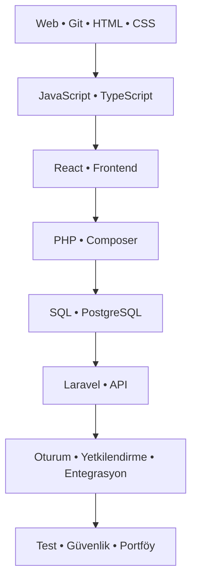

<div align="center">

# FULLSTACK45

### Full-Stack Web Geliştirici Yol Haritası

**45 günlük rota · 45 ayrı klasör · Açıklamalı örnekler · Uygulamalı öğrenme**

`HTML` · `CSS` · `JavaScript` · `TypeScript` · `React`  
`PHP` · `Composer` · `Laravel` · `SQL` · `PostgreSQL`

[Başlamadan önce](BASLANGIC.md) · [İlerleme takibi](ILERLEME.md) · [Katkıda bulun](CONTRIBUTING.md) · [Destek](mailto:info@egepekkolay.com.tr)

**Hazırlayan: Ege Pekkolay**

</div>

---

## Bu repo ne sunuyor?

Temel HTML, CSS ve JavaScript bilen geliştiriciler için frontend'den PHP/Laravel backend geliştirmeye uzanan Türkçe bir öğrenme rotası. İçerik doğrudan GitHub üzerinde okunur. Her günün ayrı klasöründe konu anlatımı, açıklamalı örnek, alıştırma, kontrol listesi ve resmî kaynak bağlantısı bulunur.

Kendi alıştırmalarını ayrı bir çalışma reposunda geliştir. Günlük ortalama 3–4 saat önerilir; süre öğrenme hızına göre değişir. Amaç kavramları uygulamak ve uçtan uca geliştirme becerisini ilerletmektir.

## Nasıl ilerlemeli?

1. [Başlangıç rehberini](BASLANGIC.md) oku ve bulunduğun aşamanın ortamını hazırla.
2. Günün klasörünü aç; örneği çalıştırmadan önce çıktısını tahmin et.
3. Alıştırmayı yap, hata senaryosunu dene ve kendi koduna Türkçe açıklamalar ekle.
4. Tamamlanma kriterlerini doğrula ve [ilerleme listeni](ILERLEME.md) güncelle.

## Öğrenme haritası



### Web temelleri

| Gün | Konu | Çalışma |
| --- | --- | --- |
| 01 | [Web ve Git](gun-01-web-ve-git/README.md) | [Alıştırmalar](gun-01-web-ve-git/ALISTIRMALAR.md) |
| 02 | [Semantik HTML](gun-02-semantik-html/README.md) | [Alıştırmalar](gun-02-semantik-html/ALISTIRMALAR.md) |
| 03 | [Formlar ve erişilebilirlik](gun-03-formlar/README.md) | [Alıştırmalar](gun-03-formlar/ALISTIRMALAR.md) |
| 04 | [CSS ve responsive düzen](gun-04-css-responsive/README.md) | [Alıştırmalar](gun-04-css-responsive/ALISTIRMALAR.md) |
| 05 | [JavaScript veri temelleri](gun-05-javascript-temelleri/README.md) | [Alıştırmalar](gun-05-javascript-temelleri/ALISTIRMALAR.md) |
| 06 | [DOM ve olaylar](gun-06-dom-olaylar/README.md) | [Alıştırmalar](gun-06-dom-olaylar/ALISTIRMALAR.md) |

### Asenkron JavaScript ve TypeScript

| Gün | Konu | Çalışma |
| --- | --- | --- |
| 07 | [Asenkron JavaScript ve HTTP](gun-07-async-http/README.md) | [Alıştırmalar](gun-07-async-http/ALISTIRMALAR.md) |
| 08 | [TypeScript temel tipler](gun-08-typescript/README.md) | [Alıştırmalar](gun-08-typescript/ALISTIRMALAR.md) |
| 09 | [Union tipler ve daraltma](gun-09-typescript-union/README.md) | [Alıştırmalar](gun-09-typescript-union/ALISTIRMALAR.md) |

### React ve frontend

| Gün | Konu | Çalışma |
| --- | --- | --- |
| 10 | [React ve bileşenler](gun-10-react-baslangic/README.md) | [Alıştırmalar](gun-10-react-baslangic/ALISTIRMALAR.md) |
| 11 | [Props ve bileşen tasarımı](gun-11-react-props/README.md) | [Alıştırmalar](gun-11-react-props/ALISTIRMALAR.md) |
| 12 | [State ve güncelleme](gun-12-react-state/README.md) | [Alıştırmalar](gun-12-react-state/ALISTIRMALAR.md) |
| 13 | [React formları](gun-13-react-formlar/README.md) | [Alıştırmalar](gun-13-react-formlar/ALISTIRMALAR.md) |
| 14 | [Yönlendirme ve URL tasarımı](gun-14-yonlendirme/README.md) | [Alıştırmalar](gun-14-yonlendirme/ALISTIRMALAR.md) |
| 15 | [Effect ve istek yaşam döngüsü](gun-15-react-effect/README.md) | [Alıştırmalar](gun-15-react-effect/ALISTIRMALAR.md) |
| 16 | [Frontend değerlendirmesi](gun-16-frontend-kontrol/README.md) | [Alıştırmalar](gun-16-frontend-kontrol/ALISTIRMALAR.md) |

### PHP ve Composer

| Gün | Konu | Çalışma |
| --- | --- | --- |
| 17 | [PHP ortamı ve temel tipler](gun-17-php-temelleri/README.md) | [Alıştırmalar](gun-17-php-temelleri/ALISTIRMALAR.md) |
| 18 | [PHP dizileri ve fonksiyonlar](gun-18-php-diziler/README.md) | [Alıştırmalar](gun-18-php-diziler/ALISTIRMALAR.md) |
| 19 | [PHP ile HTTP ve JSON](gun-19-php-http/README.md) | [Alıştırmalar](gun-19-php-http/ALISTIRMALAR.md) |
| 20 | [PHP nesne yönelimli tasarım](gun-20-php-oop/README.md) | [Alıştırmalar](gun-20-php-oop/ALISTIRMALAR.md) |
| 21 | [Composer ve bağımlılıklar](gun-21-composer/README.md) | [Alıştırmalar](gun-21-composer/ALISTIRMALAR.md) |
| 22 | [PHP doğrulama ve hata yönetimi](gun-22-php-dogrulama/README.md) | [Alıştırmalar](gun-22-php-dogrulama/ALISTIRMALAR.md) |

### SQL ve PostgreSQL

| Gün | Konu | Çalışma |
| --- | --- | --- |
| 23 | [PostgreSQL ve veri modeli](gun-23-postgresql-model/README.md) | [Alıştırmalar](gun-23-postgresql-model/ALISTIRMALAR.md) |
| 24 | [SQL CRUD ve parametreli sorgular](gun-24-sql-crud/README.md) | [Alıştırmalar](gun-24-sql-crud/ALISTIRMALAR.md) |
| 25 | [İlişkiler ve JOIN](gun-25-sql-join/README.md) | [Alıştırmalar](gun-25-sql-join/ALISTIRMALAR.md) |
| 26 | [Transaction ve indeksler](gun-26-sql-transaction/README.md) | [Alıştırmalar](gun-26-sql-transaction/ALISTIRMALAR.md) |

### Laravel ve API

| Gün | Konu | Çalışma |
| --- | --- | --- |
| 27 | [Laravel kurulum ve istek döngüsü](gun-27-laravel-kurulum/README.md) | [Alıştırmalar](gun-27-laravel-kurulum/ALISTIRMALAR.md) |
| 28 | [Route ve controller](gun-28-laravel-controller/README.md) | [Alıştırmalar](gun-28-laravel-controller/ALISTIRMALAR.md) |
| 29 | [Migration ve seed](gun-29-laravel-migration/README.md) | [Alıştırmalar](gun-29-laravel-migration/ALISTIRMALAR.md) |
| 30 | [Eloquent ilişkileri](gun-30-eloquent/README.md) | [Alıştırmalar](gun-30-eloquent/ALISTIRMALAR.md) |
| 31 | [Laravel Form Request](gun-31-laravel-validation/README.md) | [Alıştırmalar](gun-31-laravel-validation/ALISTIRMALAR.md) |
| 32 | [CRUD ve sayfalama](gun-32-laravel-crud/README.md) | [Alıştırmalar](gun-32-laravel-crud/ALISTIRMALAR.md) |
| 33 | [API sözleşmesi ve kontrol noktası](gun-33-api-sozlesmesi/README.md) | [Alıştırmalar](gun-33-api-sozlesmesi/ALISTIRMALAR.md) |

### Kimlik, yetki ve entegrasyon

| Gün | Konu | Çalışma |
| --- | --- | --- |
| 34 | [Kimlik doğrulama ve parola](gun-34-kimlik-dogrulama/README.md) | [Alıştırmalar](gun-34-kimlik-dogrulama/ALISTIRMALAR.md) |
| 35 | [Sanctum oturumu ve CSRF](gun-35-sanctum-csrf/README.md) | [Alıştırmalar](gun-35-sanctum-csrf/ALISTIRMALAR.md) |
| 36 | [Policy ve proje rolleri](gun-36-yetkilendirme/README.md) | [Alıştırmalar](gun-36-yetkilendirme/ALISTIRMALAR.md) |
| 37 | [Frontend ve API entegrasyonu](gun-37-api-entegrasyonu/README.md) | [Alıştırmalar](gun-37-api-entegrasyonu/ALISTIRMALAR.md) |
| 38 | [Oturum ve hata deneyimi](gun-38-hata-deneyimi/README.md) | [Alıştırmalar](gun-38-hata-deneyimi/ALISTIRMALAR.md) |

### Test, kalite ve teslim

| Gün | Konu | Çalışma |
| --- | --- | --- |
| 39 | [Backend davranış testleri](gun-39-backend-test/README.md) | [Alıştırmalar](gun-39-backend-test/ALISTIRMALAR.md) |
| 40 | [Frontend ve uçtan uca test](gun-40-frontend-test/README.md) | [Alıştırmalar](gun-40-frontend-test/ALISTIRMALAR.md) |
| 41 | [Erişilebilirlik ve performans](gun-41-erisilebilirlik-performans/README.md) | [Alıştırmalar](gun-41-erisilebilirlik-performans/ALISTIRMALAR.md) |
| 42 | [Güvenlik kontrol noktası](gun-42-guvenlik/README.md) | [Alıştırmalar](gun-42-guvenlik/ALISTIRMALAR.md) |
| 43 | [Yayınlama kavramları](gun-43-yayinlama/README.md) | [Alıştırmalar](gun-43-yayinlama/ALISTIRMALAR.md) |
| 44 | [CI ve operasyon](gun-44-ci-operasyon/README.md) | [Alıştırmalar](gun-44-ci-operasyon/ALISTIRMALAR.md) |
| 45 | [Portföy ve son değerlendirme](gun-45-portfoy/README.md) | [Alıştırmalar](gun-45-portfoy/ALISTIRMALAR.md) |

## Klasör standardı

```text
fullstack45-roadmap/
├── README.md
├── BASLANGIC.md
├── ILERLEME.md
├── CONTRIBUTING.md
├── gun-01-web-ve-git/
│   ├── README.md            # Anlatım ve yorumlu örnek
│   └── ALISTIRMALAR.md      # Görevler ve kabul kriterleri
├── gun-02-semantik-html/
│   ├── README.md
│   └── ALISTIRMALAR.md
└── ... gun-45-portfoy/
```

## Örneklerin kapsamı

Örnekler küçük ve konu odaklıdır. PHP/React/Laravel parçalarının bazıları öğrencinin kendi projesine eklenir; gereken bağlam ilgili günün anlatımında belirtilir. Bu depo tamamlanmış bir uygulama veya çalıştırılacak web sitesi içermez. Gün 43–44 öğrencinin ayrı projesinin yayınlanmasını ve otomasyonunu öğretir.

## Hatalı Kod ve Destek

**[info@egepekkolay.com.tr](mailto:info@egepekkolay.com.tr)**

Gün numarası, kullandığın sürümler, yeniden üretme adımları, beklenen sonuç ve hata mesajını paylaş. Parola veya erişim anahtarı gönderme.


